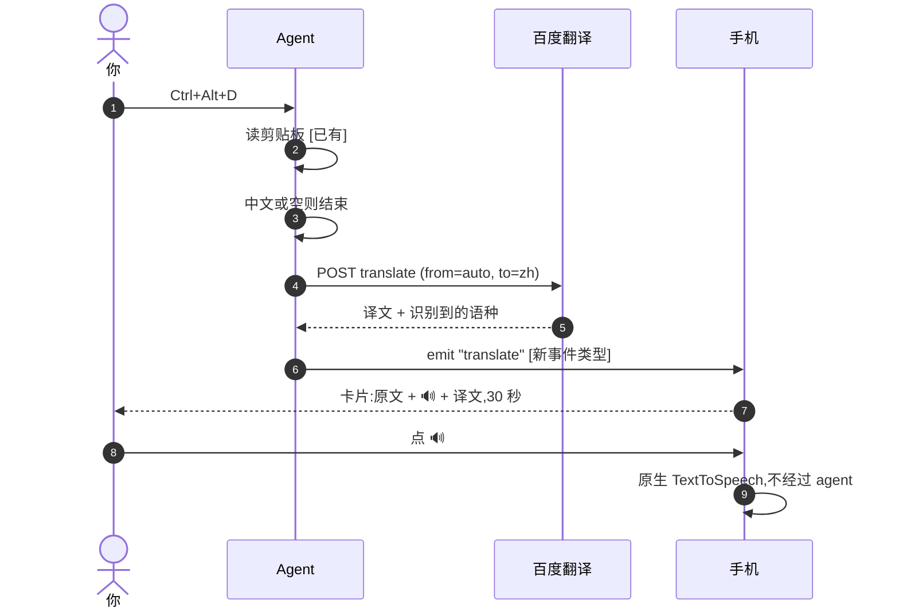

# 设计稿 v2(访谈产物,原文存档)

本文是 2026-11-24 对话中确认的设计方案的存档,作为变更 `add-translate-hotkey` 的播种来源。`proposal.md`、`design.md`、
`specs/`、`contracts.md` 以它为输入,冲突时以那些制品为准(它们记录了之后新增的决定)。

## 用户给出的决定

1. 只有原文需要一个 🔊,译文不需要。
2. 手机端显示页面不常驻:快捷键触发之后才显示,显示后 30 秒自动消失。
3. 翻译服务先接百度。
4. 本地模型不做。
5. APK 走 GitHub Actions 出包。
6. 热键 `Ctrl+Alt+D`;剪贴板是中文时不翻译;热键不自动先发 Ctrl+C(关闭)。
7. Agent 在本地构建:本机安装 .NET 10 SDK。
8. 百度 APPID 和密钥由用户获取,并填写到配置页面(不经过聊天)。

## 行为

| 情况 | 手机上的表现 |
|---|---|
| 翻译成功 | 卡片:原文 + 🔊,下面是译文;30 秒后消失 |
| 剪贴板是中文 | 不请求、不显示,只记日志 |
| 剪贴板没有文本(空、图片、文件) | 不显示,只记日志 |
| 百度报错 | 错误卡片,附百度错误码,10 秒后消失 |
| 超时或断网 | 错误卡片,10 秒后消失 |
| 卡片还在时再按热键 | 原地替换,重新计 30 秒 |
| 按 Back 键 | 立即消失 |
| 点 🔊 | 用手机自带的 TTS 朗读原文;朗读中再点一次停止 |
| 手机没有语音引擎或该语言的语音包 | 弹一条 toast 说明 |
| 手机没连着 | 事件保留 60 秒,期间连上才显示;PC 端不提示 |



## 数据契约(草案)

```json
{ "kind": "translate", "data": { "source": "hello world", "target": "你好，世界", "lang": "en-US", "seconds": 30 } }
{ "kind": "translate", "data": { "error": "provider", "detail": "52003 未授权用户", "seconds": 10 } }
```

- 传输不变,走现有的 `/api/state` 轮询和 `/api/stream`。
- `lang` 是原文的语音标签;识别不出时为 `null`,卡片不显示 🔊。
- `error` 取 `provider`(百度报错)或 `network`(超时、连不上)。手机按代码取本地化文案,`detail` 原样附上。
- 旧 APK 会静默忽略这个新类型。

## Agent 改动(C#)

| 文件 | 改动 |
|---|---|
| `Config.cs` | 新增 `TranslateConfig`:`Enabled`(默认 false)、`Hotkey`、`AppId`、`Key`、`MaxChars`;不加入 `ToPublic()` |
| `config.default*.json`(3 个) | 默认值 |
| `BaiduTranslate.cs`(新) | 签名、请求、解析、错误映射 |
| `TranslateService.cs`(新) | 编排:剪贴板 → 判定 → 调用 → 发事件 |
| `Hotkeys.cs`(新) | `RegisterHotKey` 和消息窗口,仅 Windows |
| `Program.cs` | 注册服务;启动时注册热键;保存设置后重新注册;两个本机端点 |
| `PushStore.cs` | `PanelEvent` 的注释补上 `translate` |
| `PRIVACY.md` | 新增一行出站连接 |

签名与请求(草案):

```csharp
public sealed class BaiduTranslate(ILogger<BaiduTranslate> log, HttpMessageHandler? handler = null, Func<string>? salt = null)
{
    public async Task<(BaiduTranslation? Result, string? Error)> TranslateAsync(string text, TranslateConfig cfg, CancellationToken ct)
    {
        var saltValue = (salt ?? (() => Guid.NewGuid().ToString("N")))();
        // 签名 = MD5(appid + q + salt + 密钥),32 位小写
        var sign = Convert.ToHexStringLower(MD5.HashData(Encoding.UTF8.GetBytes($"{cfg.AppId}{text}{saltValue}{cfg.Key}")));
        using var form = new FormUrlEncodedContent(new Dictionary<string, string> {
            ["q"] = text, ["from"] = "auto", ["to"] = "zh", ["appid"] = cfg.AppId, ["salt"] = saltValue, ["sign"] = sign });
        // POST https://fanyi-api.baidu.com/api/trans/vip/translate,超时 8 秒
    }
}
```

`TranslateService` 的流程:

1. 没启用或没填 APPID/密钥:直接返回。
2. 在线程池线程读剪贴板,捕获 `InvalidOperationException` 和 `TimeoutException`。
3. 规范化换行;为空或判定为中文:返回。
4. 截断到 `MaxChars` 并加 "…"。
5. 调百度。
6. `push.Emit("translate", …)`。
7. 日志只记字符数、耗时和结果,不记文本。

新增两个端点,只在本机端口可用,不加进手机白名单:

- `POST /api/translate/test`:用填写的(可未保存的)APPID 和密钥翻译 "hello",给设置页的 Test 按钮用。
- `GET /api/translate/status`:返回热键状态(`registered`、`taken`、`invalid`、`off`)。

密钥脱敏沿用 Steam key 的做法:`/api/settings` 对非桌面来源去掉 `translate.key`,保存时收到 null 就保留原值。

## 手机面板(WebView)

- `index.html`:新增 `#translate` 卡片,层级取 16。
- `style.css`:底部居中,最大高度约 60vh,内部滚动,`white-space: pre-wrap`。
- `main.js`:`showTranslate(d)`、`hideTranslate()`;`handleEvent` 加一个分支;`window.onAndroidBack` 里先关卡片;`BRIDGE` 列表加 `'speak'`。
- 🔊 复用现有图标 `volume-2`,停止态用 `volume-x`。

```js
let translateTimer = 0, translateCard = null;
export function showTranslate(d) {
  $('trSource').textContent = d.source || '';
  $('trTarget').textContent = d.error ? t('panel.translate.' + d.error) + (d.detail ? ' · ' + d.detail : '') : (d.target || '');
  translateCard = d;
  $('trSpeak').hidden = !!d.error || !d.lang || typeof bridge?.speak !== 'function';
  const box = $('translate');
  box.className = d.error ? 'err' : '';
  box.hidden = false;
  undim(); lastTouch = Date.now();
  clearTimeout(translateTimer);
  translateTimer = setTimeout(hideTranslate, (d.seconds || 30) * 1000);
}
```

## Android 原生

- `Speaker.kt`(新),放在 `Dictation.kt` 旁边。
- `MainActivity.kt`:`onCreate` 里初始化;`onPause` 停止朗读;`onDestroy` 释放;`Bridge` 加 `speak`。
- `AndroidManifest.xml`:`<queries>` 里加 `android.intent.action.TTS_SERVICE`。
- 不需要新权限。

```kotlin
fun speak(text: String, tag: String): String {
    if (speaking) { stop(); return "stopped" }
    val engine = tts ?: return "no-tts"
    when (engine.setLanguage(Locale.forLanguageTag(tag))) {
        TextToSpeech.LANG_MISSING_DATA, TextToSpeech.LANG_NOT_SUPPORTED -> return "no-voice"
    }
    speaking = true
    engine.speak(text.take(2000), TextToSpeech.QUEUE_FLUSH, null, "translate")
    return ""
}
```

读完或出错时通过现有的 `js` 回调通知面板(`window.onAndroidTts('done')`),面板把图标恢复成 🔊。

## 设置页

在 Settings › General 加一节,照 Steam 那一节的写法:启用开关、热键输入框、APPID、密钥(password 输入框)、Test 按钮、热键状态一行。

## 关键规则

1. 中文判定:含汉字,且不含日文假名和谚文。
2. 长度:默认截断到 1000 字符,可通过 `MaxChars` 调大。
3. 频率:未认证版是 1 QPS。请求串行,间隔至少 1 秒;连按时只翻最后一次。
4. 语种到语音:agent 把百度的语种代码映射成语音标签。映射表以外的语种不显示 🔊。
5. 默认关闭:填好 APPID、密钥并打开开关后才注册热键。
6. 朗读不经过 agent,不需要新增手机可访问的路径。

## 构建与安装

1. 在 GitHub 上 fork,本地加一个 remote,推功能分支。
2. 功能分支要在 Actions 页手动运行(`workflow_dispatch`)或提 PR。
3. CI 跑 `lintDebug assembleDebug testDebugUnitTest`,产物名 `phonebox-apk`。
4. 下载后用 `scripts/install-apk.ps1` 或 `adb install -r` 安装。
5. CI 是 debug 签名,和官方发行版不同,第一次要先卸载官方版并重新配对。

## 不做

译文朗读、常驻卡片、查询历史、本地模型、自动 Ctrl+C、中文译英文、其他翻译服务、手机没连时 PC 端兜底提示。
